# Entra ID + Intune Zero Trust Lab

A small hands-on lab where I set up a Microsoft 365 tenant the way a bank's security team might: identities managed in Microsoft Entra ID, MFA enforced with Conditional Access, and devices enrolled and checked for compliance in Intune.

Everything was built in my own test tenant (`YaminLab.onmicrosoft.com`) on a Microsoft 365 Business Premium trial. The "company" is a fictional bank with two staff accounts: a branch teller and a security analyst.

## What this lab covers

| Area | Tool | What I did |
|------|------|------------|
| Licensing | Microsoft 365 admin center | Activated a trial and licensed users through a group instead of one by one |
| Identity | Microsoft Entra ID | Created users, a license group, and a break-glass admin account |
| Access control | Entra Conditional Access | Built an MFA policy, tested it in report-only mode, then enforced it |
| Device management | Microsoft Intune | Created a compliance policy, enrolled a Windows 10 VM, confirmed it as compliant |

## End result

- 3 users licensed entirely through one security group (no direct license assignments)
- MFA required for every licensed user, with a break-glass account excluded so the tenant can't be locked out
- A Windows 10 VM joined to Entra ID, enrolled in Intune, and reporting **Compliant** against a Defender/firewall baseline

---

## 1. Licensing

Most of the security features I wanted are tied to a license. Conditional Access needs Entra ID P1, and device compliance needs Intune. The tenant started with nothing.

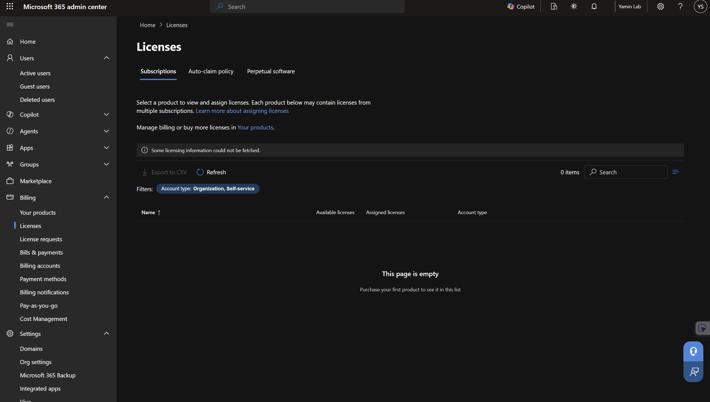

I picked **Microsoft 365 Business Premium** because it bundles Entra ID P1, Intune, and Defender for Business. I skipped Office 365 E5 on purpose: the name sounds like the top tier, but it doesn't include Intune or Entra P1, so it wouldn't have unlocked anything I needed.

Right after activating the trial, I set it to **Cancel on expiration** so it couldn't roll into a paid subscription. Small habit, but it's the same thing you'd want in a real org: no subscriptions running that nobody is tracking.

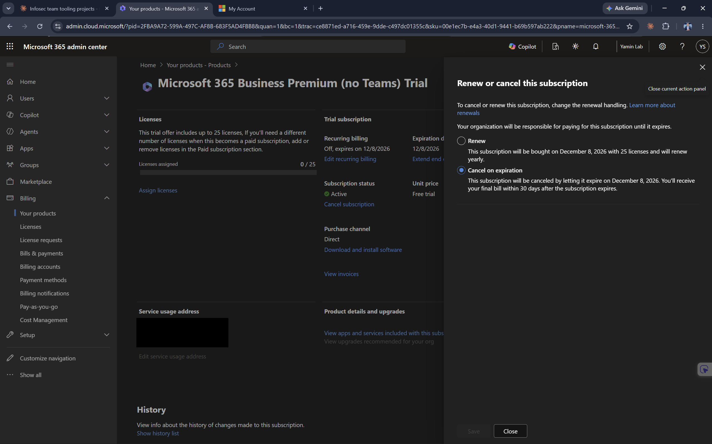

## 2. Identity (Entra ID)

### Users

I created two users with full job info filled in (title, department, usage location). Usage location is required before a user can be licensed, and job attributes are what you'd later use for dynamic groups and reporting.

| User | Job title | Department |
|------|-----------|------------|
| Sarah Mitchell | Branch Teller | Branch Operations |
| David Chen | Security Analyst | Information Security |

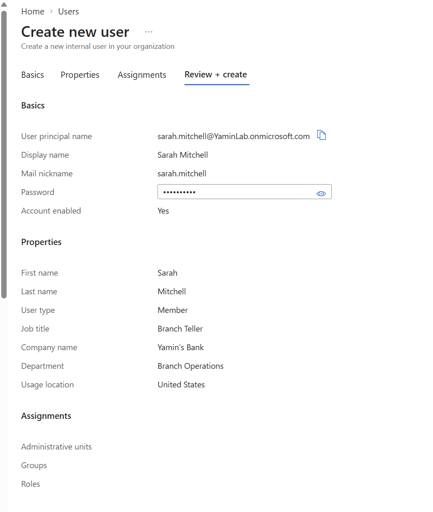

### Group-based licensing

Instead of licensing each person manually, I created one security group, `SG-M365-BusinessPremium-Users`, and assigned the license to the group. Anyone added to the group gets licensed, and anyone removed loses the license. That's how onboarding and offboarding stay clean at scale. The group also has an owner, since ownerless groups are a common audit finding.

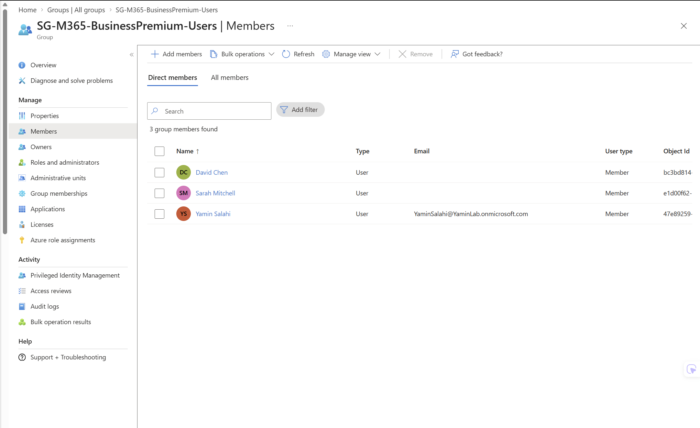

I also removed the direct license from my own admin account, so the group is the only source of licenses in the tenant.

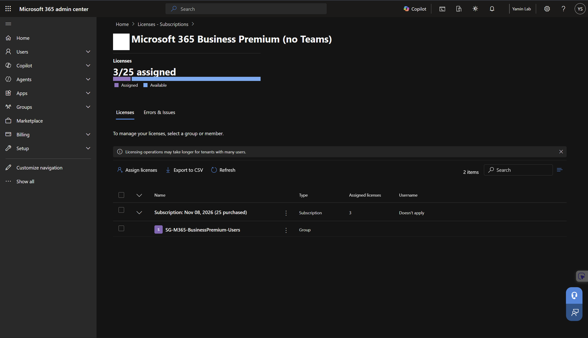

## 3. Conditional Access (MFA)

### Break-glass account first

Before building any policy, I created an emergency access account (`breakglass01`) with Global Administrator and no license. It's excluded from Conditional Access, so if a policy is misconfigured and locks everyone out, there's still a way back in. Microsoft recommends this, and in a real org the credentials would be kept offline in a vault.

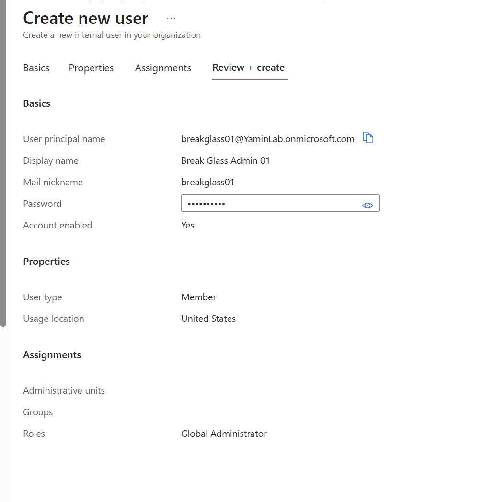

### Building the policy

New tenants have **Security Defaults** turned on, which blocks custom Conditional Access policies. I turned it off and replaced it with my own policy:

**CA001-Require-MFA-Licensed-Users**
- **Users:** `SG-M365-BusinessPremium-Users`
- **Excluded:** Break Glass Admin 01
- **Target resources:** All resources
- **Grant:** Require multifactor authentication

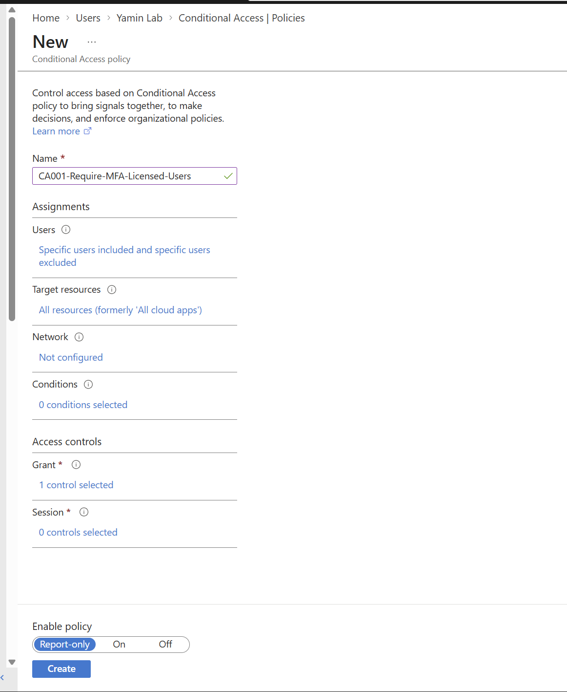

### Testing in report-only mode

I created the policy in **Report-only** mode first, which logs what the policy *would* do without blocking anyone. After signing in as Sarah, her sign-in log showed CA001 matched and would have required MFA. That's the safe way to roll out access policies: confirm the scope is right before it affects real users.

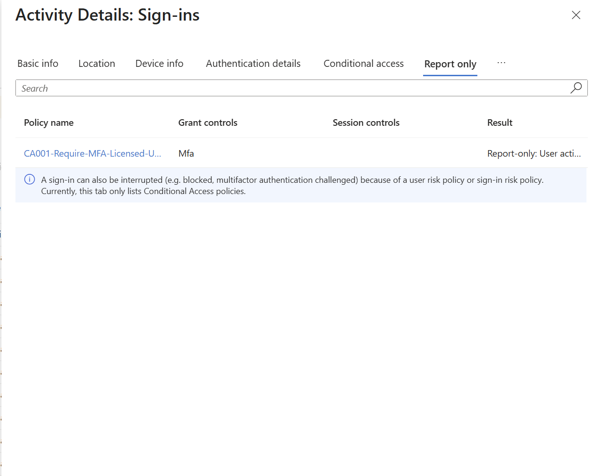

### Enforcing it

Once report-only looked right, I switched the policy **On**. Sarah's next sign-in was stopped and sent to MFA registration.

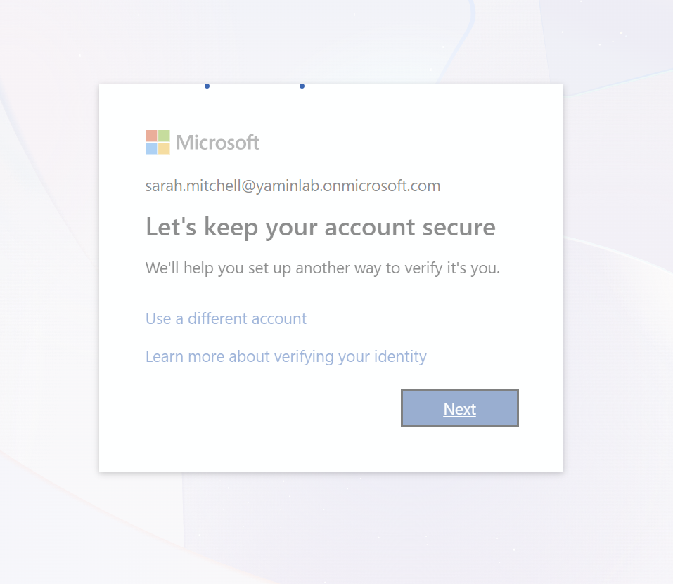

She registered Microsoft Authenticator, which uses **number matching** (typing the number shown on screen into the app). Number matching is Microsoft's defense against MFA fatigue attacks, where an attacker spams push notifications hoping someone taps Approve.

Her sign-in log then showed CA001 with grant control MFA and result **Success**: MFA was required and satisfied.

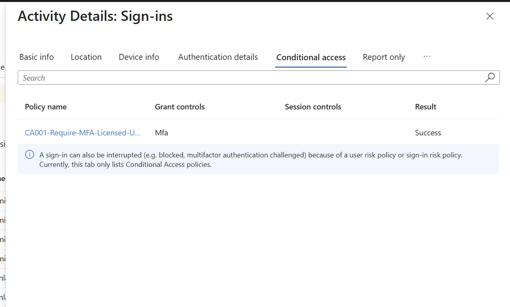

### The policy as code

I exported CA001 from the portal with **Download JSON**. It's in [`policies/CA001-Require-MFA-Licensed-Users.json`](policies/CA001-Require-MFA-Licensed-Users.json) and shows the exact configuration that the screenshots only summarize. The parts that matter:

| JSON field | Value | What it means |
|------------|-------|---------------|
| `state` | `enabled` | Policy is On (report-only shows as `enabledForReportingButNotEnforced`) |
| `includeGroups` | `7092478c-...` | Object ID of `SG-M365-BusinessPremium-Users` |
| `excludeUsers` | `073dcf29-...` | Object ID of the break-glass account |
| `includeApplications` | `All` | Applies to every resource in the tenant |
| `builtInControls` | `mfa` | Grant access only after MFA |

Having policies in JSON means they can be backed up, compared after changes, or redeployed to another tenant through Microsoft Graph instead of clicking through the portal again.

## 4. Intune (device compliance)

### Compliance policy

I created `COMP-Win-Baseline`, a Windows 10/11 compliance policy assigned to the license group. It requires:

- Firewall
- Antivirus and antispyware
- Microsoft Defender Antimalware
- Real-time protection

Any device missing one of these is marked noncompliant immediately. I left out BitLocker and TPM because a VirtualBox VM can't pass them. On real laptops, those would be the first things to add.

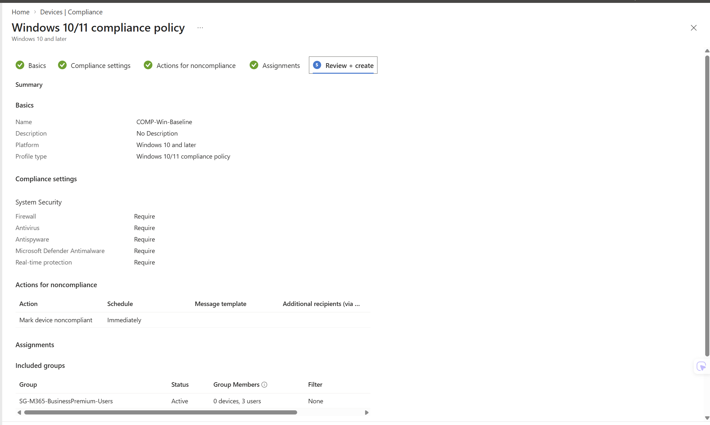

### Automatic enrollment

I set the MDM user scope to the same license group, so only licensed staff can enroll devices. That keeps everything in the lab (licensing, MFA, and device management) driven by one group.

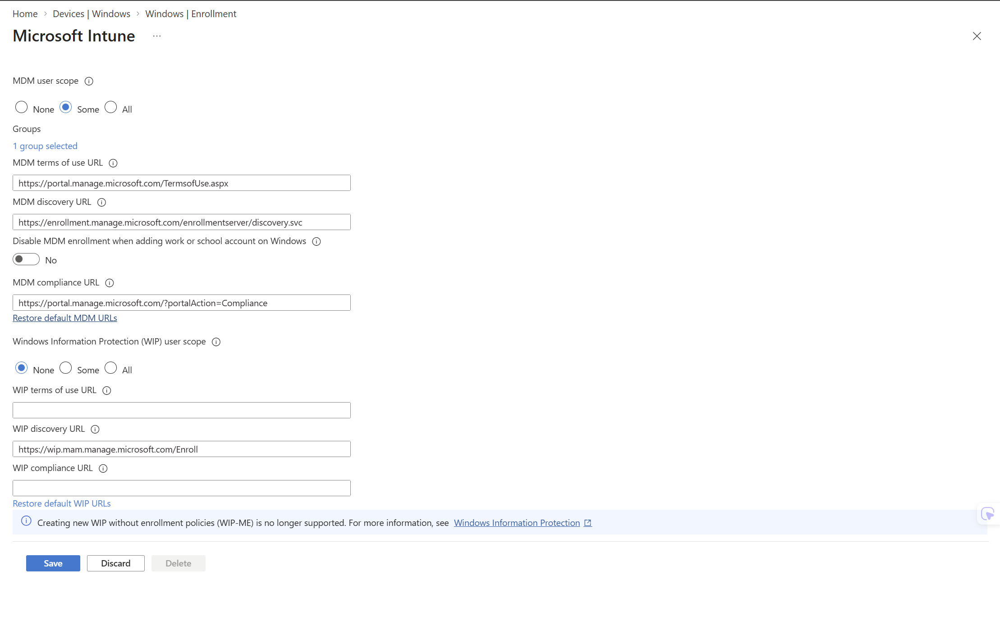

### Enrolling a Windows 10 VM

I built a fresh Windows 10 Pro VM in VirtualBox (NAT networking so it can reach Microsoft's cloud). During Windows setup I chose **Set up for an organization** and signed in as Sarah. That one step joined the device to Entra ID and enrolled it in Intune automatically, the same way a company ships a new laptop to an employee.

One snag worth noting: Windows setup kept pushing Sarah to register a passkey, which hung because a VM has no Bluetooth for the phone-to-PC passkey handoff. I turned off the Passkey (FIDO2) method and the registration campaign for this lab so she could use Authenticator instead. In a real environment I'd keep passkeys on, since they're phishing resistant, and roll them out on real hardware.

After setup, the VM showed as managed by Yamin Lab and synced successfully.

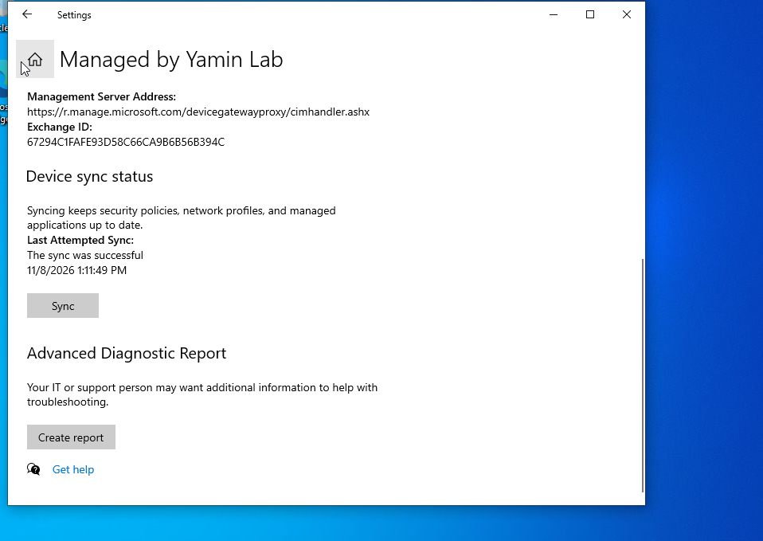

In the Intune admin center, the device showed up as Intune-managed, corporate-owned, and **Compliant**.

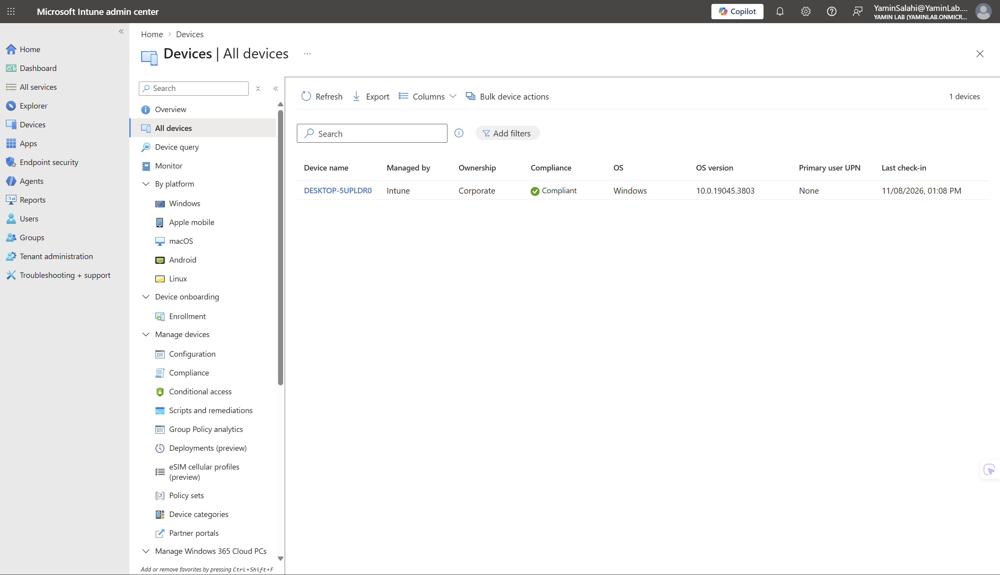

---

## Key decisions

- **Group-based everything.** Licensing, Conditional Access, compliance, and enrollment all target one group, so access follows group membership.
- **Break-glass before Conditional Access.** Never build an MFA policy without a way back in.
- **Report-only before On.** Validate the policy's scope in the sign-in logs before it can block anyone.
- **Least privilege for enrollment.** Only licensed staff can enroll devices, not "All" users.

## What I'd add next

- Require a compliant device in Conditional Access (CA002), so only healthy, managed devices can reach company data
- BitLocker and Secure Boot on real hardware
- Entra ID P2 features: Privileged Identity Management for just-in-time admin access, and access reviews

## Cleanup

The Business Premium trial was set to cancel on expiration (12/8/2026), so the tenant drops back to free Entra ID on its own.
